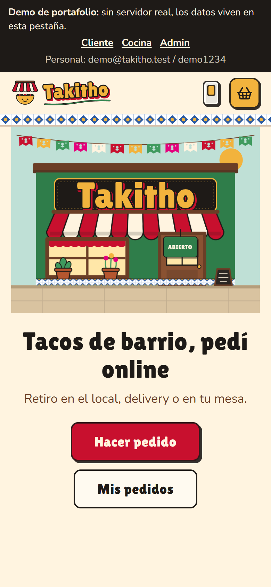
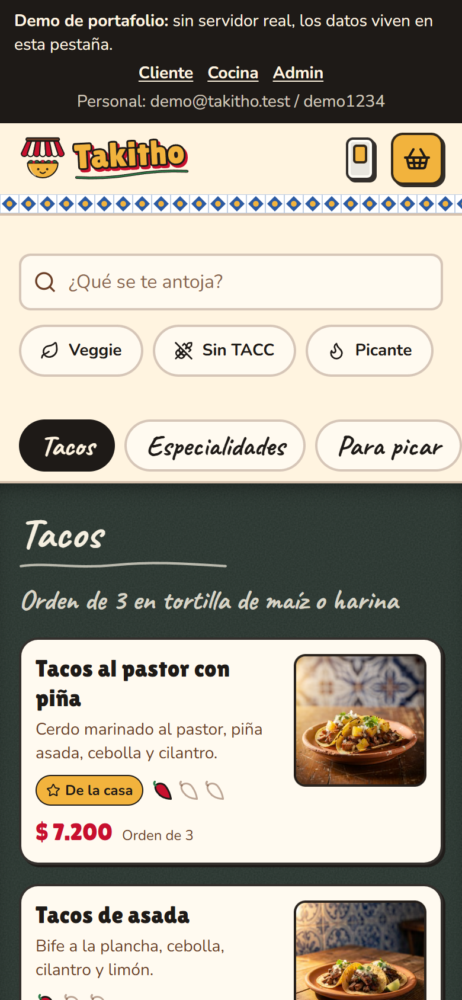
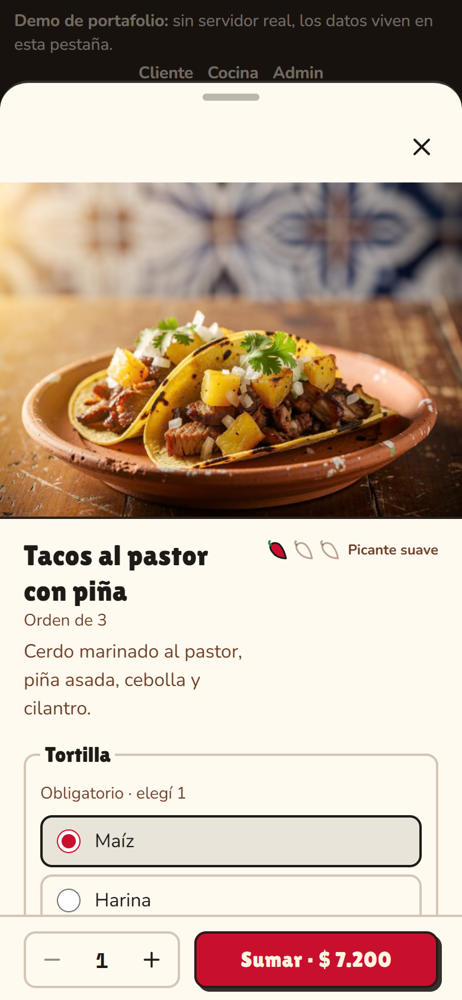
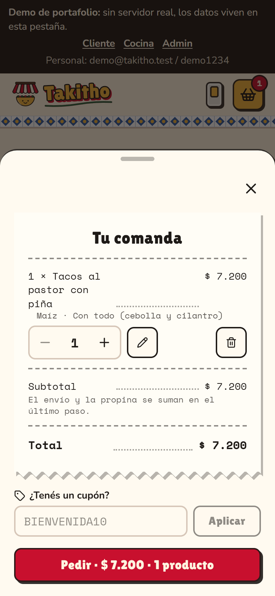
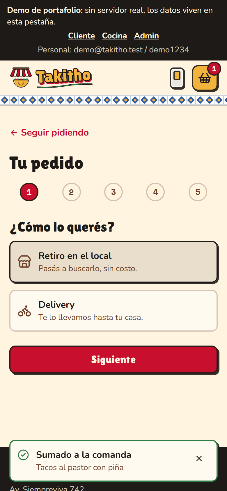
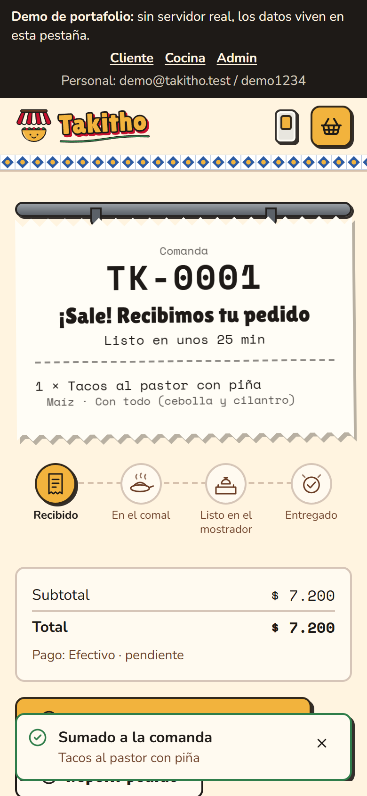
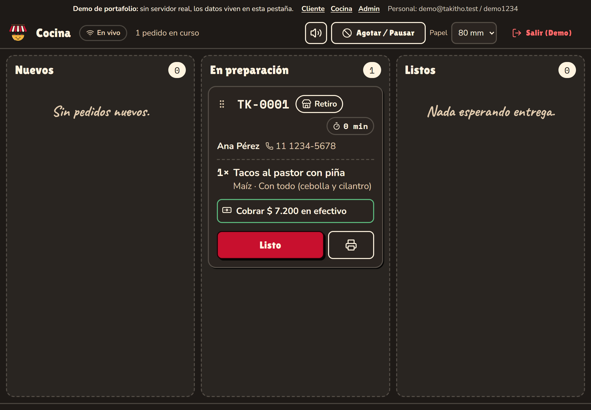
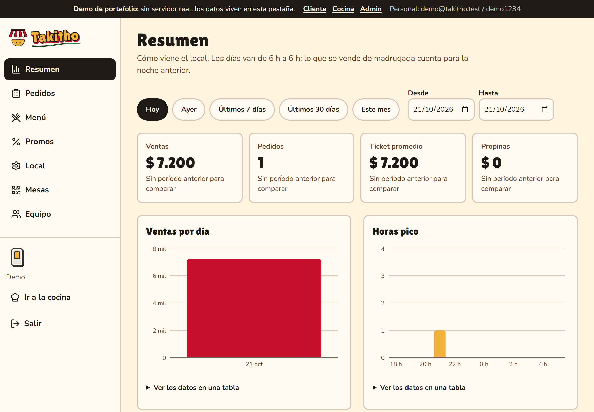
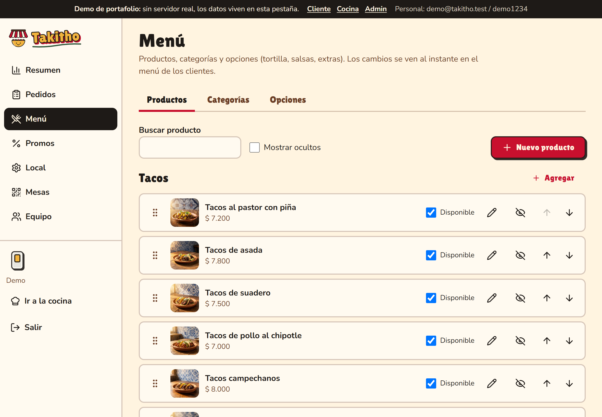
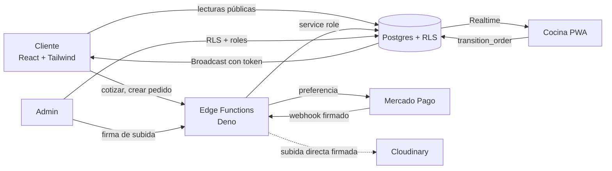

<div align="center">


### Pedidos online para una taquería de barrio

Carta y checkout para clientes, tablero de cocina en vivo y panel de administración.
Pensado para Argentina: español rioplatense, pesos, zona horaria de Buenos Aires y horarios que cruzan la medianoche.

<br />


</div>

---

## Lo que hace

<table>
<tr>
<td width="33%" valign="top">

**Clientes**<br />
Carta con fotos, opciones por producto, comanda con totales calculados en el servidor, checkout por pasos (retiro, delivery o mesa con QR), pago en efectivo, transferencia o Mercado Pago, y seguimiento en vivo.

</td>
<td width="33%" valign="top">

**Cocina**<br />
Tablero oscuro de alto contraste para tablet: Nuevos, En preparación y Listos. Aviso sonoro, timers por colores, notas resaltadas, agotar productos, pausar pedidos, impresión de comandas de 58/80 mm e instalable como app.

</td>
<td width="33%" valign="top">

**Administración**<br />
Resumen con ventas, ticket promedio, horas pico y lo más pedido. Pedidos con exportación a CSV, menú con fotos, promos y cupones, horarios, zonas, mesas con QR en PDF y equipo.

</td>
</tr>
</table>

## Capturas

El flujo del cliente, en el celular:

<table>
<tr>
<td align="center"><br /><sub>Inicio</sub></td>
<td align="center"><br /><sub>Carta</sub></td>
<td align="center"><br /><sub>Hoja de producto</sub></td>
<td align="center"><br /><sub>Comanda</sub></td>
</tr>
<tr>
<td align="center"><br /><sub>Checkout</sub></td>
<td align="center"><br /><sub>Seguimiento en vivo</sub></td>
<td colspan="2"></td>
</tr>
</table>

La cocina y la administración, en tablet y escritorio:

<p align="center">
  <br />
  <sub>Tablero de cocina</sub>
</p>

<p align="center">
  <br />
  <sub>Resumen del administrador</sub>
</p>

<p align="center">
  <br />
  <sub>Gestión del menú</sub>
</p>

## Probalo sin instalar nada: modo demo

`npm run build:demo` genera una versión que corre entera en el navegador, sin Supabase, Mercado Pago ni cuentas de nada. Los mismos handlers de las Edge Functions y los datos reales del seed funcionan sobre un backend en memoria, así que se puede pedir, cocinar y administrar en la misma pestaña.

```powershell
npm install
npm run build:demo
npm run preview:demo          # http://localhost:4175
```

Personal: `demo@takitho.test` / `demo1234`. Los datos viven en la pestaña (recargar los reinicia) y Mercado Pago queda deshabilitado. Para publicarla en Vercel como proyecto aparte: Build Command `npm run build:demo`, Output Directory `dist-demo`.

## Cómo está armado



| Decisión | Por qué |
|---|---|
| Los precios, horarios y disponibilidad los decide siempre el servidor | El navegador nunca es autoridad: un módulo puro (`src/lib/pricing.ts`) se comparte con las funciones |
| Nadie escribe `orders` salvo la Edge Function | Políticas RLS sin permisos de escritura; la máquina de estados vive en Postgres (`transition_order`) |
| "Pagado" solo lo marca el webhook de Mercado Pago | Se verifica la firma y se reconsulta el pago a la API; volver desde Mercado Pago no prueba nada |
| Seguimiento por link con token | Los clientes no tienen cuenta; el token va en la URL y el canal de Realtime |
| Cliente liviano para clientes, completo para el personal | El JS de entrada pesa 154 kB gzip sin Auth ni Storage; el cliente completo se carga solo en cocina y admin |
| Un backend en memoria compartido por los tests y la demo | Los mismos handlers reales corren en e2e, en la demo y en producción |

Las decisiones completas están en [`docs/adr/`](docs/adr/).

## Calidad

<table>
<tr>
<td align="center"><b>562</b><br /><sub>tests unitarios,<br />de componentes, SQL<br />y de funciones</sub></td>
<td align="center"><b>13</b><br /><sub>flujos e2e en Chrome<br />(incluida la demo)</sub></td>
<td align="center"><b>0</b><br /><sub>violaciones axe en<br />cliente, cocina y admin,<br />claro y oscuro</sub></td>
<td align="center"><b>100 %</b><br /><sub>cobertura del núcleo<br />(precios, horarios,<br />estados, dinero)</sub></td>
</tr>
</table>

- TypeScript estricto, ESLint, dependency-cruiser (capas de arquitectura), gitleaks y osv-scanner.
- Las reglas que no se bajan están en [`CONSTRAINTS.md`](CONSTRAINTS.md), con las métricas medidas y la brecha de performance conocida de `/menu` y `/checkout`.
- Seguridad: RLS en todas las tablas, secretos solo en las Edge Functions, límite de pedidos por IP y teléfono, CSP y headers en `vercel.json`.

## Primeros pasos

Requiere Node 24 y Windows, macOS o Linux (los scripts son multiplataforma).

```powershell
npm install
copy .env.example .env.local      # completá los VITE_*
npm run dev                       # http://localhost:5173
```

| Comando | Para qué |
|---|---|
| `npm run check:fast` | tipos, lint, formato, arquitectura y secretos (segundos) |
| `npm test` / `npm run test:cov` | unitarios, componentes, SQL (PGlite) y Edge Functions |
| `npm run test:e2e` | flujos en Chrome: retiro, delivery con Mercado Pago, cocina, admin |
| `npm run test:a11y` | axe sobre todas las pantallas |
| `npm run lighthouse` | Lighthouse móvil sobre las rutas públicas |
| `npm run size` | presupuesto de bundle |
| `npm run check:full` | todo lo anterior |

## Poner un backend real

Necesita cuentas propias, así que no se puede automatizar:

1. **Supabase.** `npx supabase login`, crear los proyectos y en cada uno `npx supabase link --project-ref <ref>`, `npm run db:push`, `npm run db:seed` y `npm run fn:deploy`. Desactivá "Allow new users to sign up". Para el primer administrador, invitá tu email y ejecutá en el SQL editor:
   ```sql
   insert into public.profiles (id, full_name, email, role)
   select id, 'Tu nombre', email, 'admin' from auth.users where email = 'tu@email.com';
   ```
2. **Secrets de las funciones.** Copiá el bloque comentado de `.env.example` a `supabase/.env.functions` (ignorado por git), completalo y corré `npm run secrets:push`.
3. **Mercado Pago.** Aplicación Checkout Pro, usuarios de prueba, `MP_ACCESS_TOKEN` y la clave del webhook (`…/functions/v1/mp-webhook`, evento Pagos). Guía de prueba: [`docs/QA-MERCADOPAGO.md`](docs/QA-MERCADOPAGO.md).
4. **Cloudinary.** Las fotos viven en `takitho/menu`; para subir nuevas desde el admin, cargá `CLOUDINARY_API_KEY` y `CLOUDINARY_API_SECRET` como secrets.
5. **Vercel.** Importá el repo y cargá `VITE_SUPABASE_URL`, `VITE_SUPABASE_PUBLISHABLE_KEY`, `VITE_CLOUDINARY_CLOUD_NAME` y `VITE_SITE_URL`.
6. **Datos reales.** En `/admin/local` reemplazá cada `[COMPLETAR]` (dirección, WhatsApp, redes, alias/CBU, zonas, horarios). La web no publica nada que siga con ese marcador.

<details>
<summary>Checklist de salida a producción</summary>

- [ ] `npm run check:full` en verde
- [ ] Migraciones aplicadas y registro público desactivado
- [ ] Secrets cargados (`MP_*`, `CLOUDINARY_*`, `ALLOWED_ORIGINS`, `SITE_URL`, `IP_HASH_SALT`)
- [ ] Cero `[COMPLETAR]` en `/admin/local` y en el menú
- [ ] Probado: pedido en efectivo, pedido con Mercado Pago, cocina recibe con sonido, QR de una mesa
- [ ] Dominio propio en Vercel y `VITE_SITE_URL`/`SITE_URL` actualizados
- [ ] Tablet de cocina: abrir `/cocina`, instalar la app y activar el sonido

</details>

## Documentación

[`PRD`](docs/PRD.md) · [`SPEC`](docs/SPEC.md) · [`API`](docs/API.md) · [`Marca`](docs/BRAND.md) · [`Decisiones (ADR)`](docs/adr/) · [`Plan`](docs/PLAN.md)

---

<div align="center">
<sub>Hecho como proyecto de portafolio. Las fotos del menú están generadas con IA.</sub>
</div>
